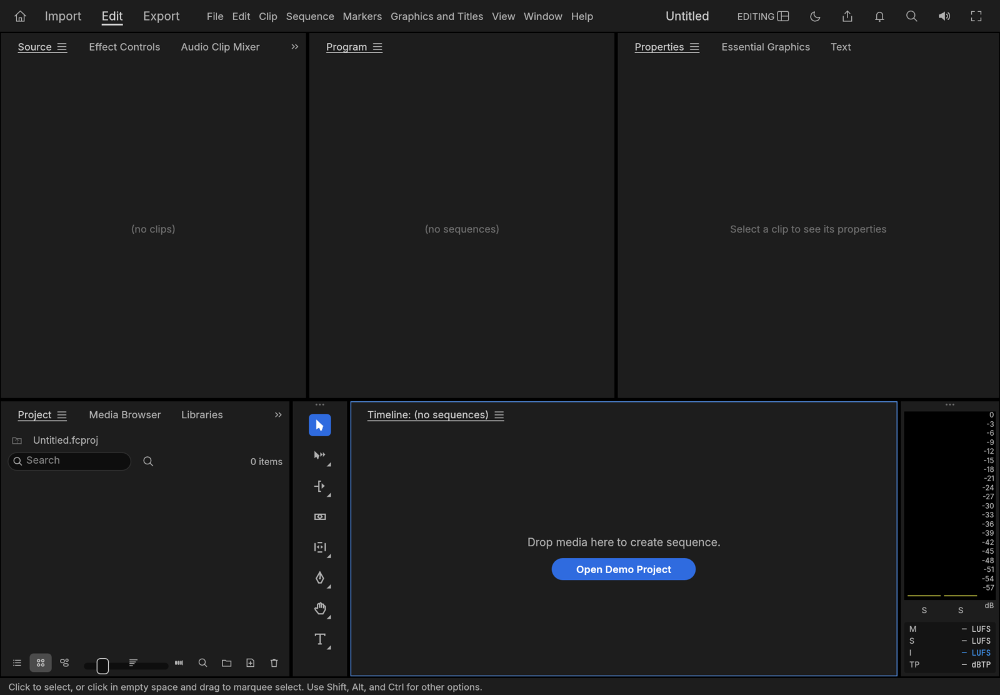

# FilmCraft for iPadOS (fork)

<p align="center">
  
  <br>
  <sub>FilmCraft on iPadOS, in landscape (iPad Air 11-inch simulator).</sub>
</p>

This fork exists only for the **iPadOS port** of FilmCraft, an open-source, clean-room nonlinear video editor
written in Rust. To learn about the project itself (features, formats, desktop and web builds, downloads, the
other Crafting Apps, contributing), read the upstream README:
**[storytold/filmcraft](https://github.com/storytold/filmcraft#readme)**.

## What this fork adds

- **`apps/filmcraft-ios`**: a Rust static-library runner (single UIKit window scene attached to winit's
  window, safe-area insets taken from UIKit every frame, audio output through cpal and CoreAudio, auto-save,
  crash recovery and preferences in the app container, browser links).
- **Files**: imports (media, projects) are streamed into the app container under file coordination, so
  large videos are never read into memory, and each import remembers where it came from. Saved projects and
  exports are written to a reserved file in the container; once a file has held still it is streamed to the
  export picker the first time and to the remembered location after.
- **`packaging/ios`**: the Xcode project that links the library into an iPad app bundle, with a bundle
  validator and tests. See its [README](packaging/ios/README.md).
- **`cargo xtask ios`**: build, install and launch on the Simulator or a physical iPad
  (`--sim`, `--device --device-id <id> --team <id> [--bundle-id <dev id>] [--release]`).
- **No Discord links.** The header button, the Help and application menu commands, the About and Home links
  and the strings in every language are gone.

## Status

Verified in the iPad Air 11-inch M3 simulator (iPadOS 26.2): the app builds, installs, launches, shows the
editor in landscape and keeps the UI inside the safe area. Host tests cover the runner's change tracking, file
copying and storage paths.

**Not yet verified, on a simulator or a device:** importing media from Files, playback and audio output,
saving and reopening a project, exporting to Files, touch and Pencil editing, Release builds and their
speed. **Not wired up:** hardware video decoding (iPadOS decodes in software for now), voice-over recording,
folder access, the system clipboard and printing. Debug builds are slow; use `--release` for any real
playback. This is a first bootstrap, not a hardware sign-off.

## Build and run

Requires macOS with Xcode and the Rust targets `aarch64-apple-ios`, `aarch64-apple-ios-sim` and
`x86_64-apple-ios`.

```sh
cargo xtask ios --sim          # build, boot, install and launch on the iPad simulator
cargo xtask ios --device --device-id <udid> --team <team id> --bundle-id <your.dev.bundle.id> --release
cargo test -p filmcraft-ios --lib
python3 -m unittest discover -s packaging/ios/tests -v
```

Contributor rules (clean-room, never crash, layering, assets) are in [`AGENTS.md`](AGENTS.md).

## License and attribution

Dual-licensed MIT OR Apache-2.0, as upstream. Assets are listed in [`ATTRIBUTION.md`](ATTRIBUTION.md).
